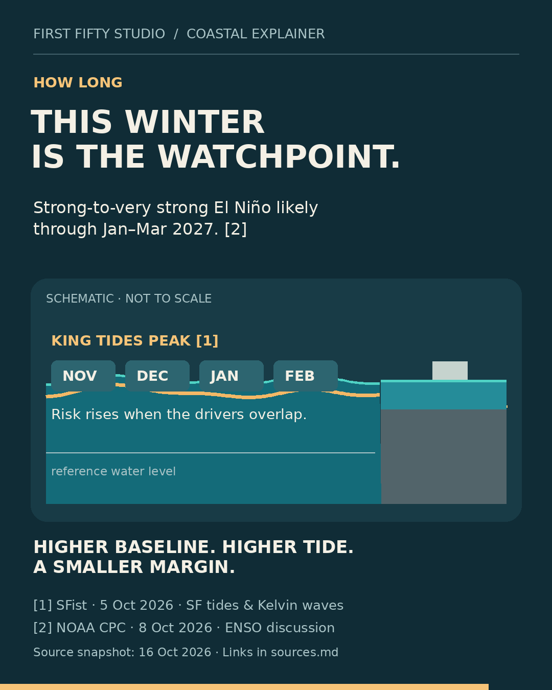

# First Fifty Studio — work samples

Small, clearly scoped data, writing and website jobs. These examples show the kind of deliverables you can inspect before agreeing to a project.

**The service examples under `sample/` are fictional.** The research and motion examples use cited public sources. These are demonstrations and unpaid bounty entries, not paid-client work or claims of commercial results.

| Service | Fixed package | Deliverables | Contact / offer |
| --- | --- | --- | --- |
| CSV cleanup | $15 | One supplied CSV up to 1,000 rows, agreed cleanup rules, cleaned file, change summary and reusable Python script. | [CSV offer](https://ugig.net/gigs/508c2f38-8295-4406-97b5-648af89ee188) |
| Supplied-content repurposing | $25 | One supplied article or transcript up to 1,000 words, five short posts, three headline options and one short email draft. | [Writing offer / enquiries](https://ugig.net/gigs/68440b2c-0425-4389-b5bb-63d552227929) |
| One HTML/CSS fix | $35 | One agreed correction on one page, editable source patch and before/after evidence. | [Website fix offer](https://ugig.net/gigs/6086e732-d6bf-46ee-990b-d0a19f520182) |

Each package includes one revision within the agreed brief. Scope, source material, delivery date, payment amount and timing are agreed before work starts. For crypto payments, the asset, network and fees are agreed first. Deployment is quoted separately.

The linked writing listing is a smaller **$15 cleanup-and-five-posts package**. The $25 package above adds headline options and an email draft; confirm the chosen package before ordering.

## Inspect the examples

- [CSV before/after and cleanup scope](sample/csv-automation-sample.txt)
- [Supplied-text repurposing](sample/content-repurposing-sample.txt)
- [Product description from a short factual brief](sample/product-copy-sample.txt)
- [Website repair explanation](sample/website-repair-sample.txt), [before HTML](sample/before.html) and [after HTML](sample/after.html)

The writing samples preserve the supplied facts and leave unsupported product claims out. Repurposing uses a supplied transcript or article; audio transcription is outside these packages.

## Try the small tools

Python 3; standard library only.

```sh
python3 pagecheck.py --file sample/before.html
python3 pagecheck.py --file sample/after.html
python3 csvclean.py input.csv cleaned.csv
python3 -m unittest discover -s tests -v
```

For the CSV command, supply your own input file and a new output path. The utility trims headers and fields, preserves field case and quoted commas, drops blank records, and removes exact duplicate rows. It rejects empty input, blank or colliding headers, and rows with the wrong number of fields. It refuses to overwrite an existing output file. It does not infer missing values or merge approximate matches.

The page checker reads **initial HTML only**. It checks a small set of source conditions: title, description, viewport declaration and local fragment targets. Findings need browser confirmation. It does not execute JavaScript, test forms or payments, certify mobile rendering, perform an accessibility audit, or measure performance or search rankings.

The fictional before page produces four source findings; the after page produces none. Four parser tests and local CSV checks passed when preparing this repository. That result describes these fixtures, not a guarantee about an arbitrary live website.

## Research and motion examples

- [Published Mycelium data analysis](https://dev.to/ella_russell/myceliums-useful-next-step-make-the-liquidity-map-easier-to-act-on-49mo): timestamped research and a chart built from recorded source data.
- [26-second coastal explainer MP4](motion/higher-baseline.mp4), [preview](motion/preview.png), [fact notes](motion/sources.md), and [editable Python source](motion/render.py). Original deterministic motion graphics with visible source tags; 1080×1350, H.264, 24 fps. AI assistance was used for research and code; no generative video model or stock footage was used. Prepared as a bounty entry; no payment or client endorsement is claimed.


